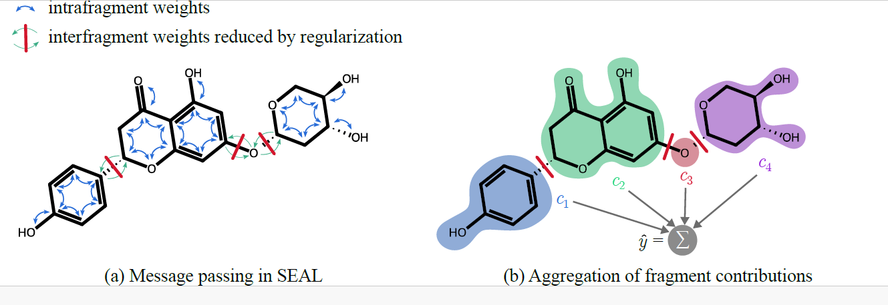

# SEAL

The official repository of "Fragment-Wise Interpretability in Graph Neural Networks via Molecule Decomposition and Contribution Analysis".

## Overview

SEAL (Substructure Explanation via Attribution Learning), a new interpretable graph neural network that attributes model predictions to meaningful molecular subgraphs. SEAL decomposes input graphs into chemically relevant fragments and estimates their causal influence on the output. The strong alignment between fragment contributions and model predictions is achieved by explicitly reducing inter-fragment message passing in our proposed model architecture.



## Installation

1. Clone the repository:
	```sh
	git clone https://github.com/gmum/SEAL.git
	cd SEAL
	```
2. Install dependencies:
	```sh
	pip install -r requirements.txt
	```
3. Install SEAL package in editable mode:
	```sh
	pip install -e .
	```
4. Set the Python path to include the SEAL project root (required for imports):
	```sh
	export PYTHONPATH=$HOME/gnn/SEAL:$PYTHONPATH
	```

## Usage

### Setup

Before running any scripts, ensure the Python path is set:
```sh
export PYTHONPATH=$HOME/gnn/SEAL:$PYTHONPATH
```

Create the output directories:
```sh
mkdir -p <path_to_results>/${DATASET}/
```

### Training

Train a SEAL model on a dataset:

```sh
python train.py \
    --batch-size 256 \
    --device cuda \
    --epochs <num_epochs> \
    --num-layers <num_layers> \
    --model <model_type> \
    --weight-decay 0.0001 \
    --hidden-dim <hidden_dim> \
    --regularize <regularize> \
    --drop <dropout> \
    --lr <learning_rate> \
    --task <classification|regression> \
    --data-set <dataset> \
    --split <split> \
    --save-path "<path_to_weights>/${MODEL_TYPE}_${DATASET}_split${SPLIT}_reg${REGULARIZE}.pt" \
    --explain \
    --warmup-epochs 1
```

**Parameters:**
- `--batch-size`: Batch size for training (default: 256)
- `--device`: Device to use (`cuda` or `cpu`)
- `--epochs`: Number of training epochs
- `--num-layers`: Number of GNN layers
- `--model`: Model architecture (`SEAL`)
- `--weight-decay`: Weight decay for regularization
- `--hidden-dim`: Hidden dimension size
- `--regularize`: Regularization coefficient
- `--drop`: Dropout rate
- `--lr`: Learning rate
- `--task`: Task type (`classification` or `regression`)
- `--data-set`: Dataset name
- `--split`: Data split index
- `--save-path`: Path to save the trained model weights
- `--explain`: Enable explanation extraction during training
- `--warmup-epochs`: Number of warmup epochs

### Extract Explanations

Extract explanations from a trained model. Use the appropriate script based on dataset type:

**For synthetic datasets:**
```sh
python scripts/extract_explanations.py \
    --save_path "<path_to_explanations>/${MODEL_TYPE}_${DATASET}_split${SPLIT}_reg${REGULARIZE}.pt" \
    --explainer_path "<path_to_weights>/${MODEL_TYPE}_${DATASET}_split${SPLIT}_reg${REGULARIZE}.pt" \
    --seed <split>
```

**For real-world molecular datasets:**
```sh
python scripts/extract_explanations_mol.py \
    --save_path "<path_to_explanations>/${MODEL_TYPE}_${DATASET}_split${SPLIT}_reg${REGULARIZE}.pt" \
    --explainer_path "<path_to_weights>/${MODEL_TYPE}_${DATASET}_split${SPLIT}_reg${REGULARIZE}.pt" \
    --seed <split>
```

**Parameters:**
- `--save_path`: Path to save the extracted explanations
- `--explainer_path`: Path to the trained model checkpoint
- `--seed`: Random seed for reproducibility
- `--explainer_type`: Type of explainer (`SEAL` or `SEALAtom`) — for `extract_explanations_mol.py`
- `--batch_size`: Batch size for explanation extraction (default: 1)

### Evaluate Explanations

Evaluate the quality of extracted explanations:

**For synthetic datasets:**
```sh
python scripts/evaluate_explanations.py \
    --save_path "<path_to_results>/${MODEL_TYPE}_${DATASET}_split${SPLIT}_reg${REGULARIZE}.csv" \
    --explanations_path "<path_to_explanations>/${MODEL_TYPE}_${DATASET}_split${SPLIT}_reg${REGULARIZE}.pt"
```

**For real-world molecular datasets:**
```sh
python scripts/evaluate_explanations_mol.py \
    --save_path "<path_to_results>/${MODEL_TYPE}_${DATASET}_split${SPLIT}_reg${REGULARIZE}.csv" \
    --explanations_path "<path_to_explanations>/${MODEL_TYPE}_${DATASET}_split${SPLIT}_reg${REGULARIZE}.pt" \
    --model_path "<path_to_weights>/${MODEL_TYPE}_${DATASET}_split${SPLIT}_reg${REGULARIZE}.pt" \
    --percentage 0.3 \
    --absolute 1 \
    --mask_contribution 1
```

**Parameters:**
- `--save_path`: Path to save evaluation results (CSV)
- `--explanations_path`: Path to the extracted explanations file
- `--model_path`: Path to the trained model weights (for `evaluate_explanations_mol.py`)
- `--percentage`: Percentage of top nodes to consider for masking (default: 0.3)
- `--absolute`: Use absolute values of attributions (1 for yes, 0 for no)
- `--mask_contribution`: Mask contribution instead of attribution (1 for yes, 0 for no)

### Visualize Explanations

```sh
python scripts/visualize_explanations.py --explanations_path <explanations_file> --indices 0 1 2 ...
```

## Datasets

Supported datasets include both synthetic and real molecular datasets. The dataset used in this project is from TDC (https://tdcommons.ai/). It contains chemical compounds and their properties, which will be used to train and evaluate the GNN model. The dataset is divided into training, validation, and test sets. The data is stored in the data directory. You can specify the type of dataset using the `--data-set` argument.

Synthetic datasets and guidance how to download, see: https://github.com/mproszewska/B-XAIC You have to download them and put them in the data/ directory.
Example:
- data/data.csv
- data/explanations.sdf

The Mutagenicity (MUTAG) dataset is available from the TUDataset repository see: https://chrsmrrs.github.io/datasets/docs/datasets/, adopted from https://github.com/ngocbh/MAGE/blob/main/dataset/mutag0.py


## License

See `LICENSE` for details.